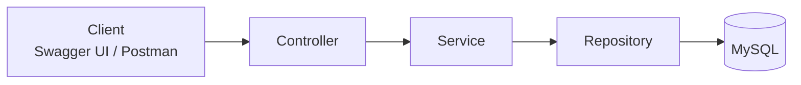

<div align="center">


<a href="https://git.io/typing-svg"></a>

<br/>


</div>

---

## 📌 About The Project

A RESTful backend application for managing employee records, built with **Java, Spring Boot, Spring Data JPA and MySQL**. It follows a clean layered architecture and includes request validation, centralized exception handling and interactive API documentation through Swagger UI.

## ✨ Features

- ✅ Create, read, update and delete employees (full CRUD)
- 🔍 Filter employees by department (case-insensitive)
- 🛡️ Request validation: required fields, valid email, positive salary
- 📧 Duplicate email detection with a clear error message
- ⚠️ Centralized error handling using `@RestControllerAdvice`
- 📖 Interactive API documentation and testing with Swagger UI

## 🛠️ Tech Stack

<div align="center">


</div>

| Layer | Technology |
|-------|------------|
| Language | Java 17 |
| Framework | Spring Boot 3.3 |
| Persistence | Spring Data JPA (Hibernate) |
| Database | MySQL 8 |
| Validation | Jakarta Bean Validation |
| API Docs | Swagger UI (springdoc-openapi) |
| Build Tool | Maven |

## 🏗️ Architecture



| Layer | Responsibility |
|-------|----------------|
| Controller | Handles HTTP requests and responses |
| Service | Business logic and rules |
| Repository | Database access through Spring Data JPA |
| Exception | Converts errors into clean JSON responses |

## 📂 Project Structure

```
src/main/java/com/ayush/ems
├── EmployeeManagementApplication.java
├── controller
│   └── EmployeeController.java
├── service
│   └── EmployeeService.java
├── repository
│   └── EmployeeRepository.java
├── model
│   └── Employee.java
└── exception
    ├── ResourceNotFoundException.java
    └── GlobalExceptionHandler.java
```

## 🔗 API Endpoints

Base URL: `http://localhost:8080/api/employees`

| Method | Endpoint | Description | Success |
|:------:|----------|-------------|:-------:|
|  | `/api/employees` | Create a new employee | `201` |
|  | `/api/employees` | Get all employees | `200` |
|  | `/api/employees?department=IT` | Filter by department | `200` |
|  | `/api/employees/{id}` | Get an employee by id | `200` |
|  | `/api/employees/{id}` | Update an employee | `200` |
|  | `/api/employees/{id}` | Delete an employee | `204` |

### 📨 Sample Request

`POST /api/employees`

```json
{
  "name": "Ravi Sharma",
  "email": "ravi@example.com",
  "department": "IT",
  "salary": 45000
}
```

### 📬 Sample Response `201 Created`

```json
{
  "id": 1,
  "name": "Ravi Sharma",
  "email": "ravi@example.com",
  "department": "IT",
  "salary": 45000
}
```

<details>
<summary><b>❌ Error response examples (click to expand)</b></summary>

<br/>

**Employee not found** — `GET /api/employees/99` returns `404`

```json
{
  "timestamp": "2026-11-08T08:09:49",
  "status": 404,
  "message": "Employee not found with id 99"
}
```

**Duplicate email** — returns `400`

```json
{
  "timestamp": "2026-11-08T08:12:10",
  "status": 400,
  "message": "Employee with this email already exists"
}
```

**Validation failure** (invalid email or negative salary) — returns `400`

```json
{
  "timestamp": "2026-11-08T08:13:02",
  "status": 400,
  "errors": {
    "email": "Enter a valid email",
    "salary": "Salary must be greater than 0"
  }
}
```

</details>

## 🚀 Getting Started

### Prerequisites

- JDK 17 or higher
- Maven (or the Maven bundled with your IDE)
- MySQL 8

### Run Locally

**1. Clone the repository**

```bash
git clone https://github.com/AyushBhaturkar/EmployeeManagementSystem.git
cd EmployeeManagementSystem
```

**2. Configure the database** in `src/main/resources/application.properties`

```properties
spring.datasource.url=jdbc:mysql://localhost:3306/ems_db?createDatabaseIfNotExist=true&useSSL=false&allowPublicKeyRetrieval=true&serverTimezone=UTC
spring.datasource.username=root
spring.datasource.password=YOUR_MYSQL_PASSWORD
```

> The `ems_db` database and the `employees` table are created automatically on the first run.

**3. Start the application**

```bash
mvn spring-boot:run
```

Or run `EmployeeManagementApplication` from your IDE.

**4. Open Swagger UI** to explore and test the APIs

```
http://localhost:8080/swagger-ui.html
```

## 💡 Key Concepts Used

- Layered architecture to separate HTTP handling, business logic and data access
- Spring Data JPA derived queries such as `findByDepartmentIgnoreCase`
- Bean Validation with `@NotBlank`, `@Email` and `@Positive`
- Global exception handling with `@RestControllerAdvice` and `@ExceptionHandler`
- Constructor-based dependency injection
- Correct HTTP status codes (201, 204, 400, 404)

## 🔮 Future Improvements

- [ ] Authentication and authorization with Spring Security and JWT
- [ ] Pagination and sorting for the employee list
- [ ] DTOs instead of exposing the entity directly
- [ ] Unit and integration tests with JUnit and Mockito
- [ ] Docker support and cloud deployment

## 👨‍💻 Author

<div align="center">

**Ayush Bhaturkar**
B.Tech (Data Science) · G.H. Raisoni College of Engineering, Nagpur

[](https://github.com/AyushBhaturkar)
[](https://www.linkedin.com/in/ayushbhaturkar/)
[](mailto:bhaturkar.ayush@gmail.com)


</div>
